# Allay AI

💬 **Allay** puts an AI helper into your server’s chat, named after the friendly mob that brings players what they need. A player types `/ask`, or just writes in chat mode, and gets an answer grounded in their real game: their inventory, what they’re looking at, the chests around them, your server’s recipes and rules.

## In the game

### Videos

#### A house from your chests

<a href="https://github.com/allay-ai/minecraft/blob/master/media/screenshots/en/build.mp4">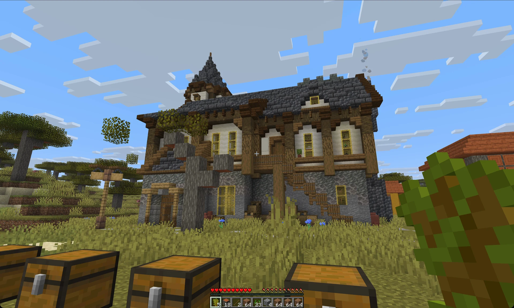</a>
   “Find a medieval house with a tower”: the preview, a move, what it takes, then Allay builds it from the chests in front of you.
    <a href="https://github.com/allay-ai/minecraft/blob/master/media/screenshots/en/build.mp4">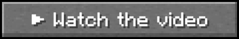</a>

#### Furnaces, smokers, and potions at once

<a href="https://github.com/allay-ai/minecraft/blob/master/media/screenshots/en/kitchen.mp4">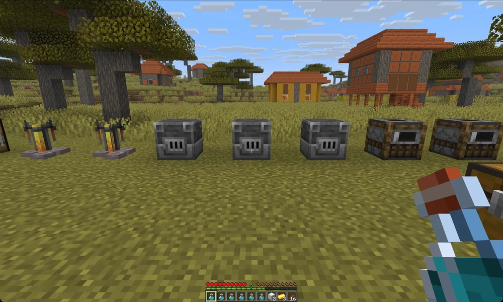</a>
   One request starts agents side by side: blast furnaces smelt, smokers cook, stands brew, and the ingots become blocks. The wait is sped up.
    

#### Chests in order

<a href="https://github.com/allay-ai/minecraft/blob/master/media/screenshots/en/sort.mp4">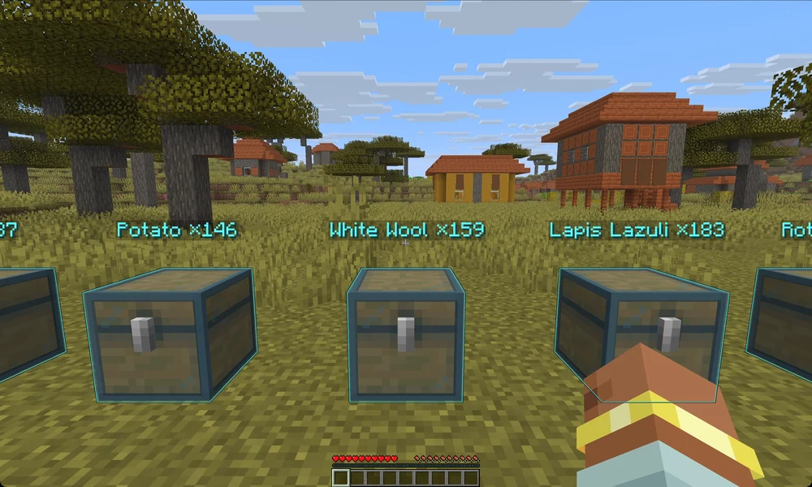</a>
   Six messy chests: Allay shows the plan over them, and on your yes every item moves to its place.
    

### Short clips

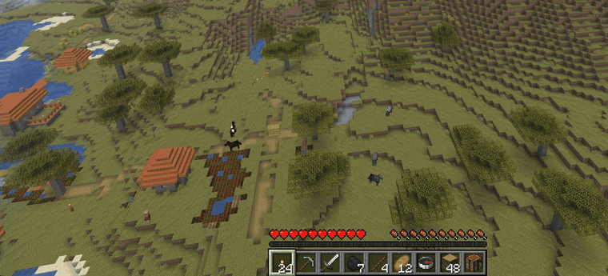

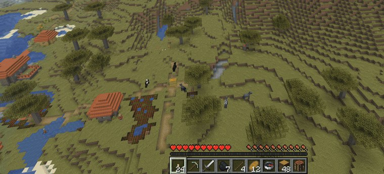
   Allay writes to the others for you, and nothing goes out until you press Send

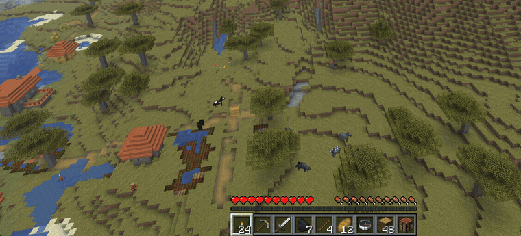
   Ask what someone wrote, and Allay translates it and drafts your reply in their language

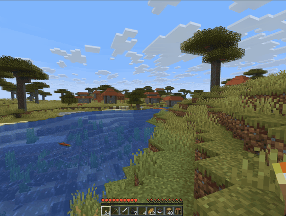
   Ask for a recipe, press Recipe, and the server’s own recipe opens

   Ask for the way, and a trail leads there with an arrow on top

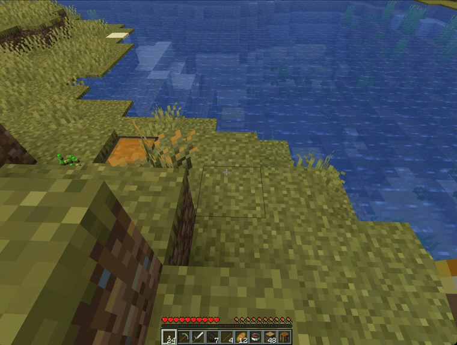
   Ask where something lies, and its chests glow, even through the ground

### Screenshots

  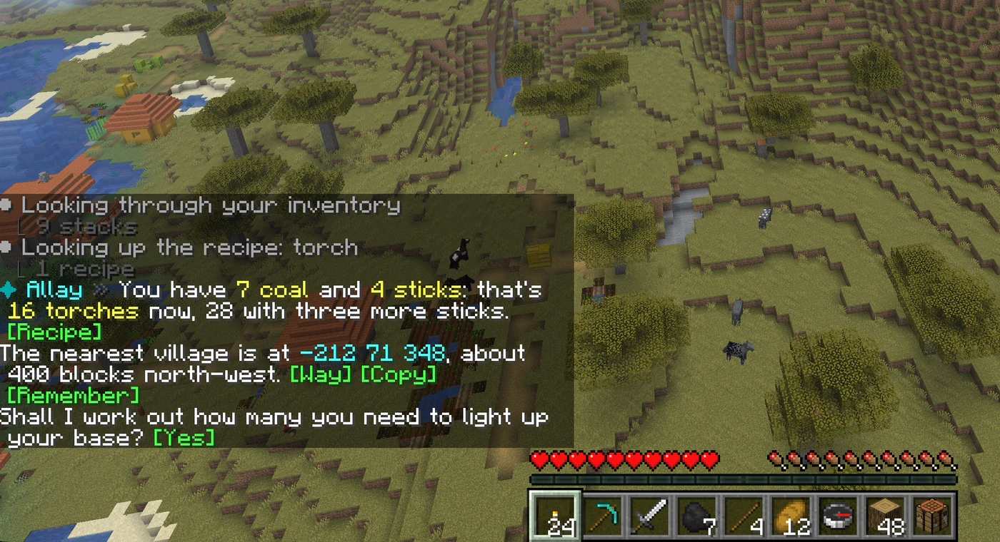
  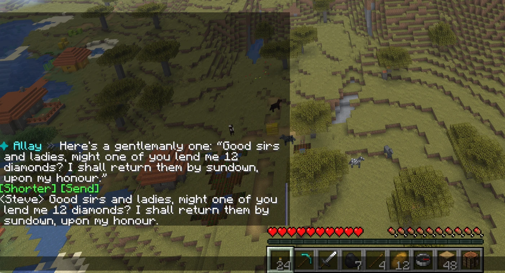
   Buttons sit right in the answer · The message Allay wrote, sent by its button

  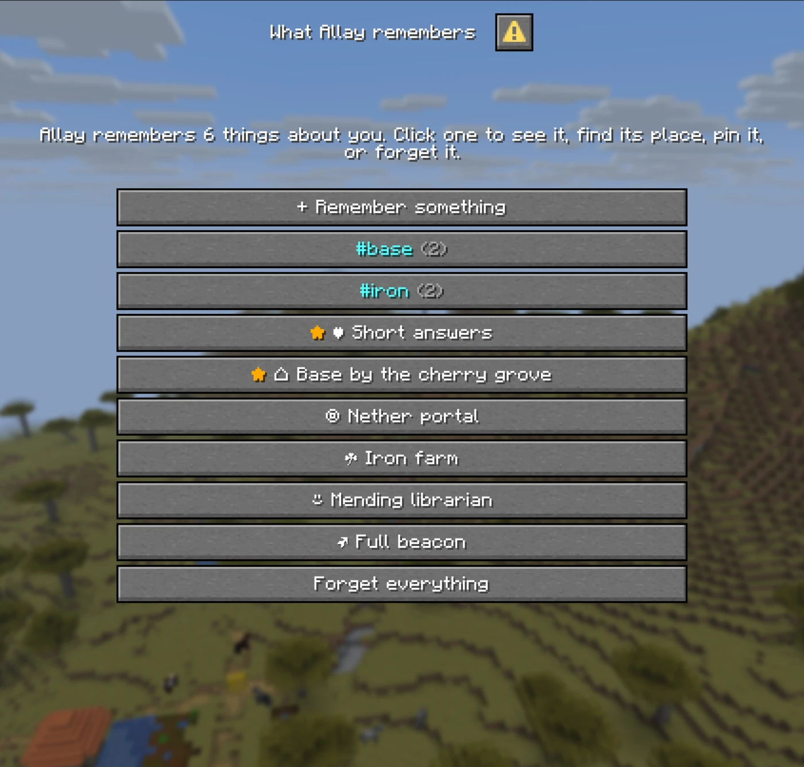
  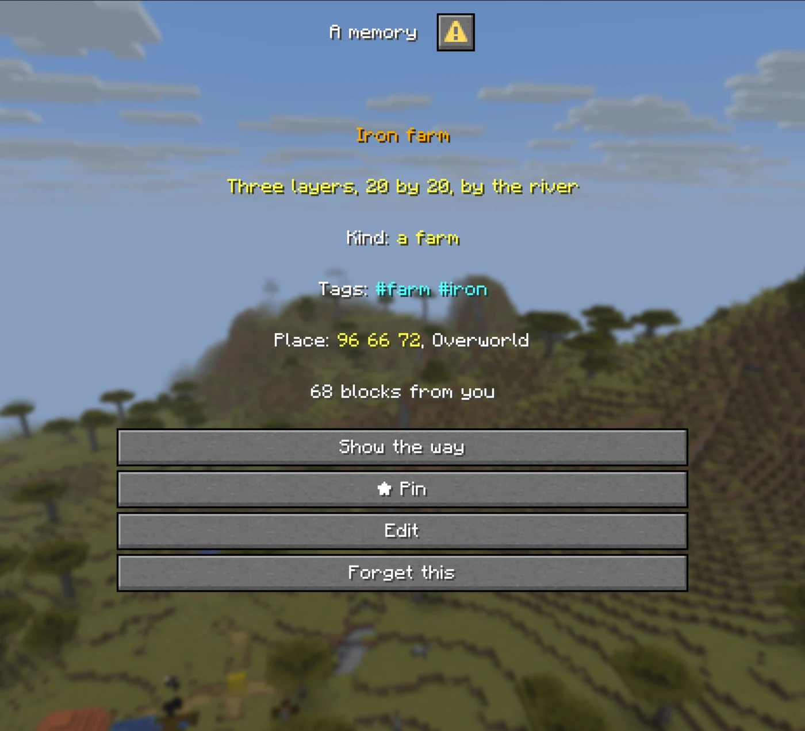
   What Allay remembers, in the game’s own window · A memory with its tags and the way there, to pin, edit, or forget

  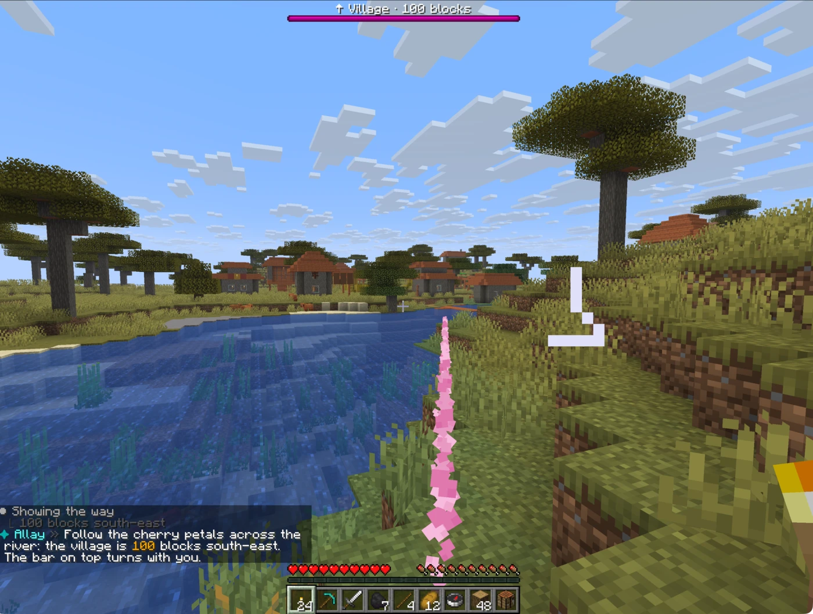
  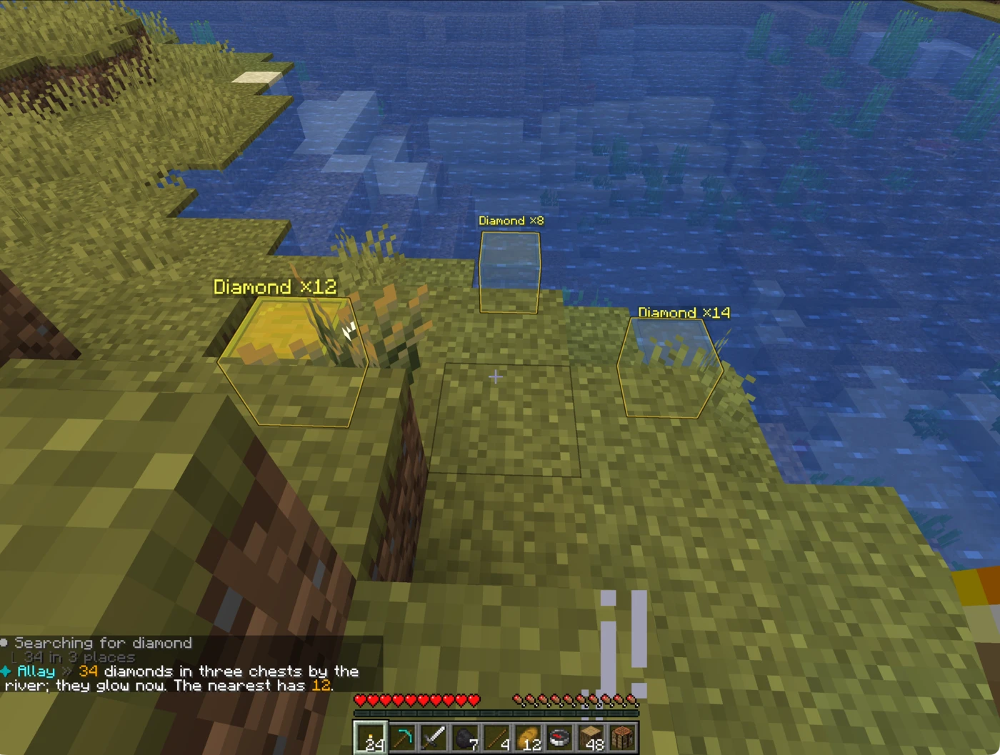
   The trail to the village · Chests that hold diamonds, lit up

  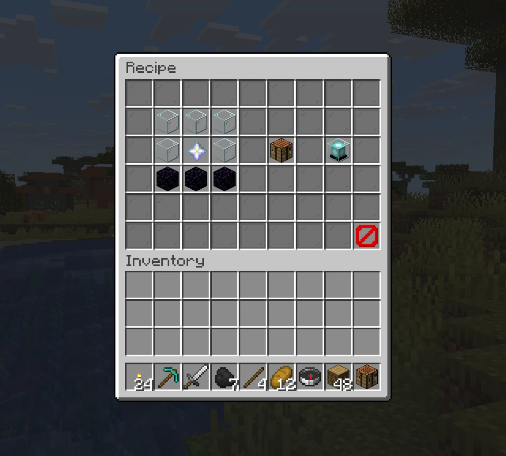
  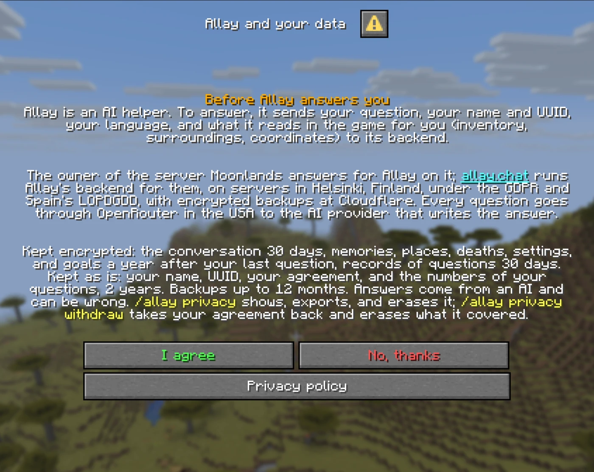
   The recipe window · Every player reads what Allay sends and keeps before the first question

## What you get

- 💬 **Answers from the real game.** “Which sword is better?” or “where did I put my redstone?”: Allay looks into the inventory, the block under the crosshair, and the chests around instead of guessing.
- 🔎 **It knows this server’s things.** Mods’ items, data packs’ recipes and brews, and plugins’ own items count: Allay finds them by name in any language or by id, and never says a thing doesn’t exist before it looked. It knows the commands you may run here too, and whose each is, so `/askx` writes a plugin’s command the way the plugin wants it.
- 🗨️ **Chat mode.** `/allay chat` sends whatever a player writes to Allay, and `/askall` asks in front of everyone.
- 📜 **It reads the chat with you.** “What did he just write?”, “translate that”, “who swore the most today?”, “is his offer a scam?”: Allay reads the server's chat of the last 72 hours, as you saw it. “Tell him I have no diamonds” gets a reply in his language with a **Reply** button, privately when he wrote to you privately.
- 🧭 **It shows and marks.** A particle trail to a death point, a village, or a friend on the locator bar. Glowing marks on the chests that hold what you look for.
- 🤖 **Automation agents do the chores.** They sort chests, smelt evenly, brew potions in rounds, and craft at a real table while you keep playing.
- 🏠 **Real builds, built from your blocks.** “Find me a modern villa” brings builds by their authors from Allay's catalog. You see one as a preview only you see, turn it, swap its materials, and Allay builds it block by block from your chests, waiting for what's short. Off until you turn it on (`building.enabled`).
- 🧹 **A tidy inventory.** “Sword first, food in the last row”, and **[Put back]** undoes it.
- 🪟 **Buttons and windows.** Buttons sit right in the answer: the way somewhere, a recipe, brewing steps, the cheapest anvil order, enchantments, villager trades, or a message Allay wrote for you to send. Memory and privacy open as the game’s own windows.
- 🌍 **Every player reads their own language.** English, Russian, Spanish, Portuguese, and German, picked by country or chosen with `/allay language`.
- 🔒 **Fair and safe.** Allay sees only the asker’s things, never gives items to regular players, and respects claims and vanish: GriefPrevention on Spigot and Paper; Flan and Open Parties and Claims in the mods, and the claims mods behind Common Protection API on Fabric. PlaceholderAPI (Text Placeholder API in the mods), LuckPerms, and Plan (not on NeoForge) work too.
- 🧱 **A plugin and a mod.** The same Allay runs as a plugin on Spigot and Paper, and as a mod on Fabric and NeoForge: on a dedicated server, or in your own singleplayer world, where it helps just you.
- 🛡️ **Private by design.** Your server signs in to the backend, which keeps each server’s players apart. `/allay privacy` tells a player what’s kept and erases it on request, and full privacy hides their name from the backend’s admin panel.

## Privacy and the law

Allay is **EU (GDPR) and US privacy law friendly**. Here is what it does with players’ data on the hosted backend, [allay.chat](https://allay.chat/privacy/), under the GDPR, Spain’s LOPDGDD, COPPA, and the CCPA/CPRA:

- 🇪🇺 **Stored in the EU**, on servers in Helsinki, Finland. Encrypted nightly backups sit with Cloudflare R2 for up to 12 months.
- 🔐 **Sealed with AES-256-GCM:** conversations, memories and places, deaths, settings and goals, and records of questions. Not sealed: the players directory (name, UUID, operator status), the numbers of each question, and the record of each agreement.
- ⏳ **Kept for:** a conversation 30 days; memories, places, deaths, and settings a year after the player’s last question; records of questions 30 days; the numbers and the players directory 2 years.
- 🌐 **Every question goes through OpenRouter in the USA** to the AI provider that writes the answer.
- ✋ **Age and agreement first.** Before the first question a window asks a player from the EU or the US their age, which must reach their country’s age of consent (13 to 16 in the EU, 14 in Spain, 13 in the US), and every player agrees to a short notice, again whenever it changes. Below that age, Allay answers nothing and sends nothing. With allay.chat no setting in `config.yml` switches this off.
- 📦 **Players control their data.** `/allay privacy` shows what’s kept, gives a 24-hour download link, and erases it. `/allay privacy withdraw` takes the agreement back and erases what it covered.
- 👥 **Other players stay unnamed.** A player who didn’t agree reaches the AI only as “Player 1”, “Player 2”. The chat history is the exception: the chat shows everyone's name to everyone anyway.
- 📜 **The chat, 72 hours, sealed.** While the owner keeps chat history on, the backend keeps the server's chat for 72 hours: public lines for everyone, local lines for those who saw them, private messages for their two players only. `/allay chathistory reset` erases it.
- 🧹 **Your server keeps almost nothing:** a player’s data stays in memory while they play, and Allay’s folder holds only sealed lists of who agreed and who was too young.

## Get started

1. Put Allay in, on Java 25:
   - **Spigot or Paper 26.3:** the Spigot version’s jar into `plugins/`, then restart the server.
   - **Fabric 26.3:** the Fabric version’s jar and [Fabric API](https://modrinth.com/mod/fabric-api) into `mods/` of a server or of your own game. Kotlin is inside, so nothing else is needed.
   - **NeoForge 26.3:** the NeoForge version’s jar into `mods/` of a server or of your own game. Kotlin is inside, so nothing else is needed.
2. As an operator, run `/allay link` for a subscription, or put your own OpenRouter key into `provider.byok` in `config.yml` (`plugins/Allay/` on Spigot and Paper, `config/allay/` in the mods) and run `/allay reload`. In singleplayer the world’s owner can do it, cheats or not.
3. Type `/ask how do I craft a beacon?`.

Everything else, from your own backend to every config key, lives in the [wiki on GitHub](https://github.com/allay-ai/minecraft/wiki). Plugin and mod authors can extend Allay with their own tools, items, and advice: see [Expansions](https://github.com/allay-ai/minecraft/wiki/Expansions).

## Related projects

- **[Moonlands](https://minecraft.mairwunnx.com)** – the hard-survival server where all of these run.
- **[WorldAPI](https://github.com/MairwunNx/minecraft-worldapi)** – REST and WebSocket API to the world, players, and stats of a Paper, Fabric, or NeoForge server.
- **[Minecraft MCP](https://github.com/MairwunNx/minecraft-mcp)** – lets an AI client read and run a server through WorldAPI.
- **[Allay Server](https://github.com/allay-ai/server)** – the backend behind Allay.
- **[Mo’Joins](https://github.com/MairwunNx/mojoins)** – join and quit messages in each player’s language.
- **[Mo’Afks](https://github.com/MairwunNx/moafks)** – a safe AFK mode that doesn’t block the night.
- **[Mo’Bosses](https://github.com/MairwunNx/mobosses)** – monsters that spawn as bosses with classes, abilities, and loot.
- **[minecraft-exporter](https://github.com/MairwunNx/minecraft-exporter)** – Prometheus metrics from WorldAPI.
- **[minecraft-grafana](https://github.com/MairwunNx/minecraft-grafana)** – the Grafana dashboard for WorldAPI.

[IP Geolocation by DB-IP](https://db-ip.com), licensed under CC BY 4.0.
