# Allay

  
  
  
  
  
  
  
  
  

💬 **Allay** приводит в чат сервера ИИ-помощника, названного в честь дружелюбного моба, который приносит игрокам нужное. Игрок пишет `/ask` или просто пишет в чат в режиме чата и получает ответ, привязанный к его настоящей игре: к инвентарю, к тому, на что он смотрит, к сундукам вокруг, к рецептам и правилам этого сервера.

[English version](https://github.com/allay-ai/minecraft/blob/master/README.md)

Allay работает на Moonlands — моём хардкорном выживании с друзьями. Заходите на `ru.minecraft.mairwunnx.com` и спросите его о чём-нибудь.

## В игре

### Видео

#### Дом из ваших сундуков

<a href="https://github.com/allay-ai/minecraft/blob/master/media/screenshots/ru/build.mp4">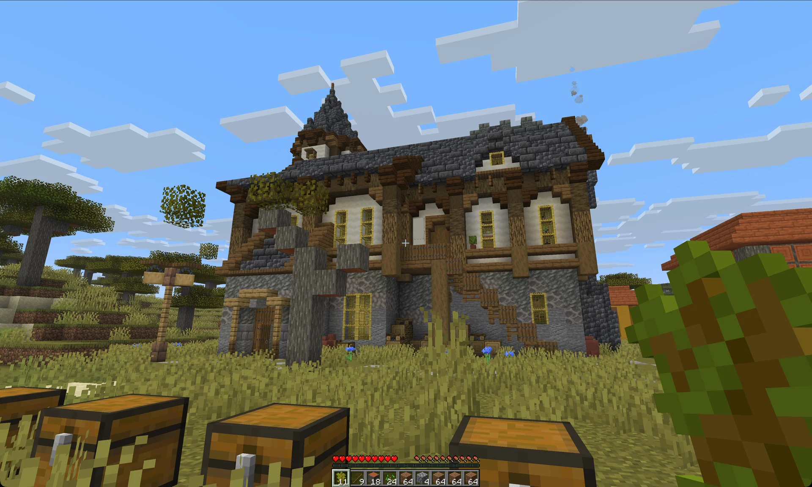</a>
   «Найди средневековый дом с башней»: превью, сдвиг, смета, и Allay строит его из сундуков перед вами.
   <a href="https://github.com/allay-ai/minecraft/blob/master/media/screenshots/ru/build.mp4">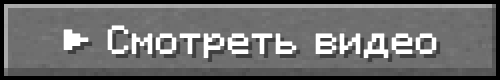</a>

#### Печи, коптильни и зелья разом

<a href="https://github.com/allay-ai/minecraft/blob/master/media/screenshots/ru/kitchen.mp4">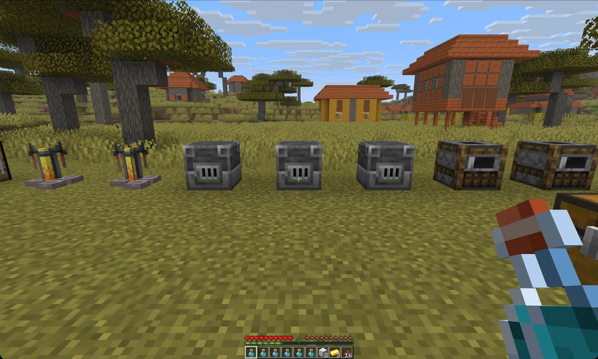</a>
   Одна просьба запускает агентов параллельно: доменные печи плавят, коптильни жарят, стойки варят, а из слитков выходят блоки. Ожидание ускорено.
   

#### Порядок в сундуках

<a href="https://github.com/allay-ai/minecraft/blob/master/media/screenshots/ru/sort.mp4">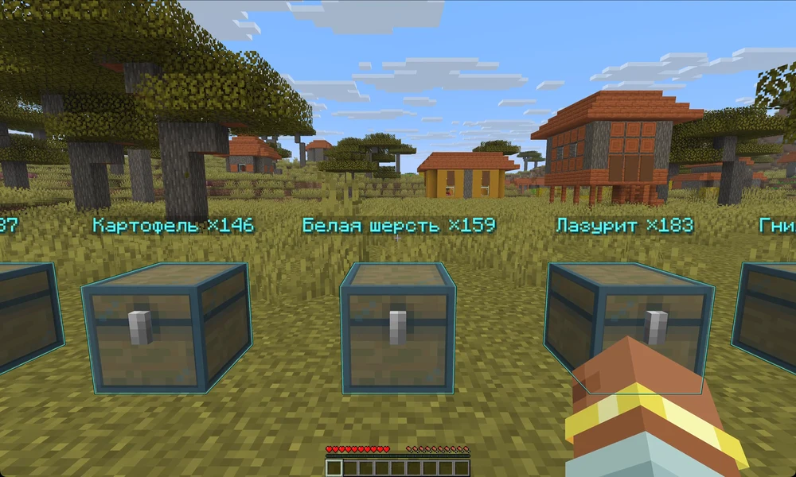</a>
   Шесть сундуков вперемешку: Allay показывает план над ними и после вашего «да» раскладывает всё по местам.
   

<a href="https://allay.chat/ru/gallery/">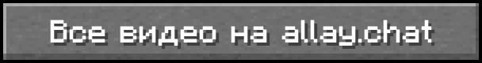</a>

### Короткие ролики

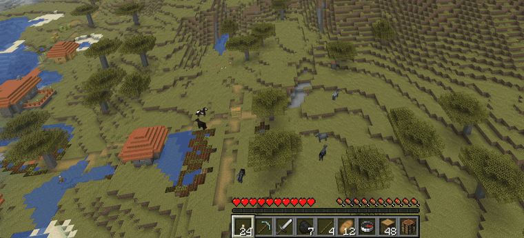

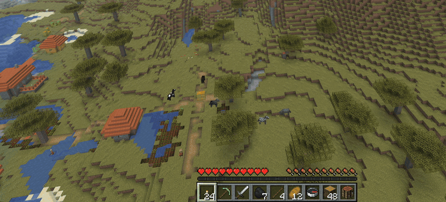
   Allay пишет другим за вас, и ничего не уйдёт, пока вы не нажмёте «Отправить»

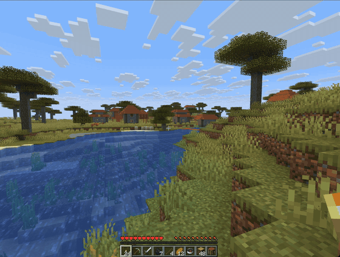
   Спросите рецепт, нажмите «Рецепт», и откроется рецепт этого сервера

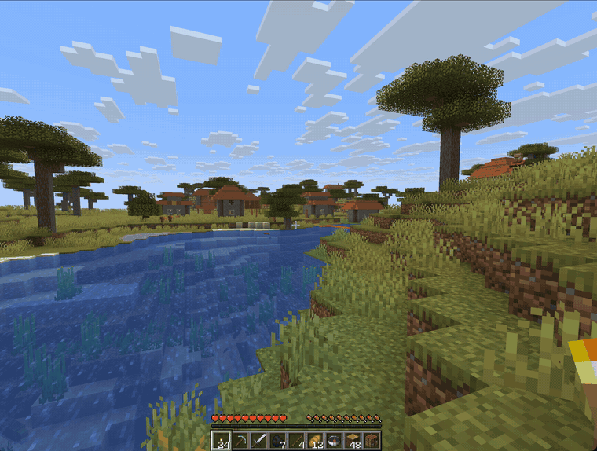
   Спросите дорогу, и к месту поведёт тропа со стрелкой сверху

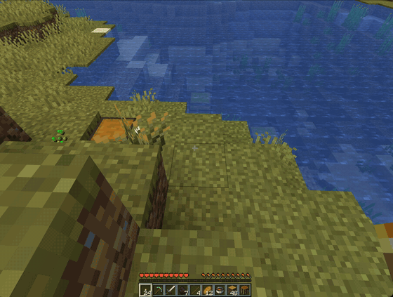
   Спросите, где что лежит, и сундуки подсветятся даже сквозь землю

### Скриншоты

  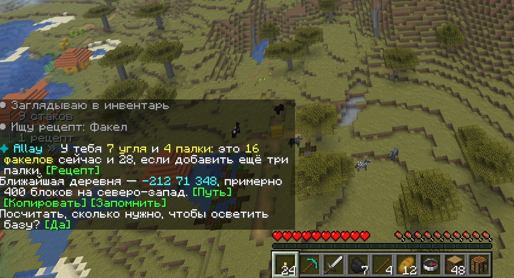
  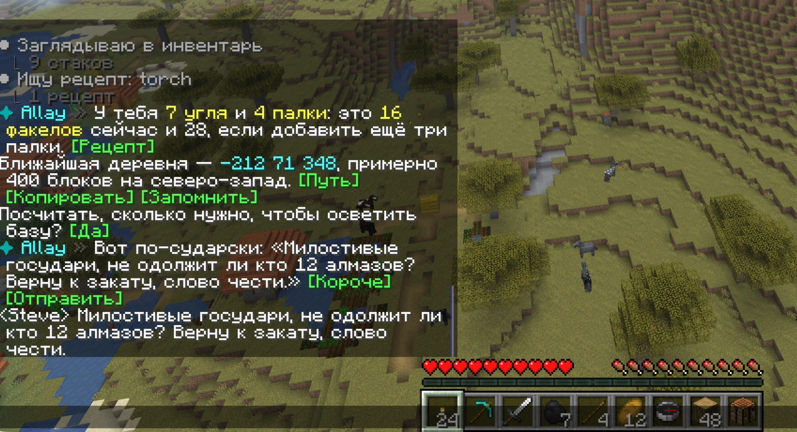
   Кнопки прямо в ответе · Сообщение, которое написал Allay, отправлено кнопкой

  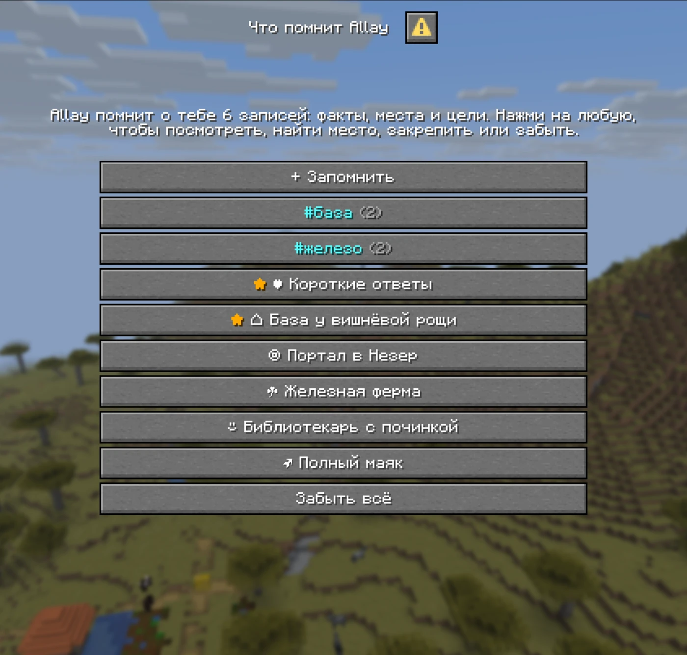
  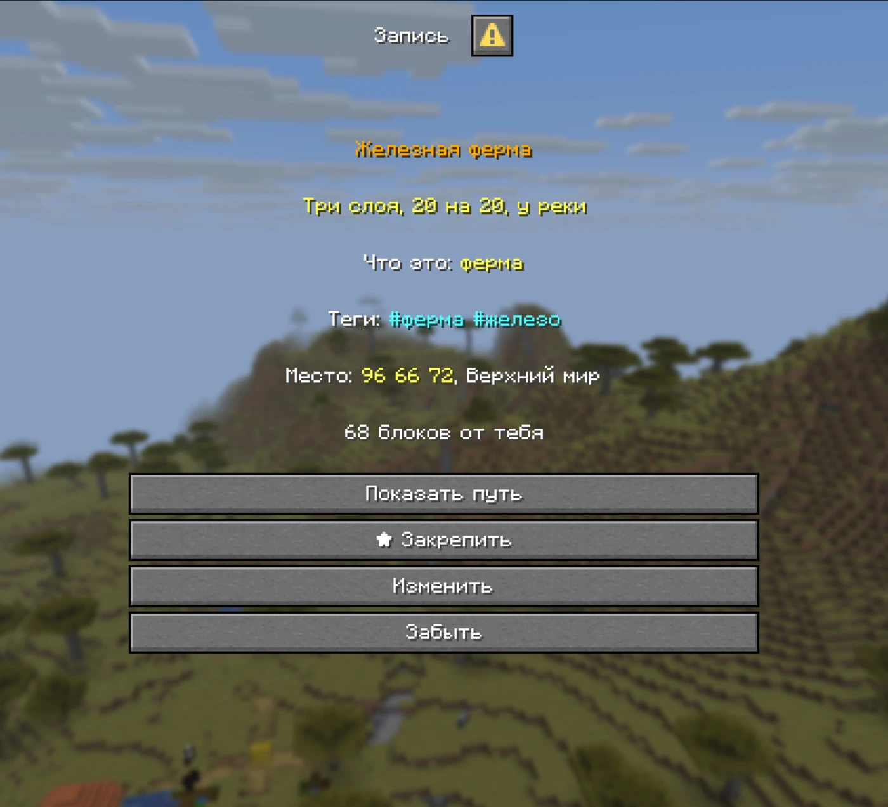
   Что помнит Allay, в окне самой игры · Запись с тегами и дорогой к месту: закрепить, изменить или забыть

  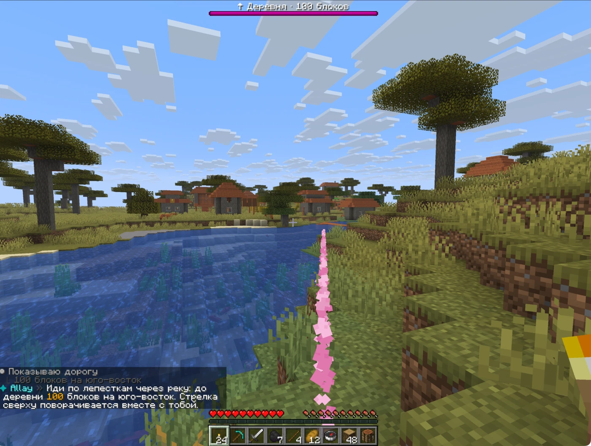
  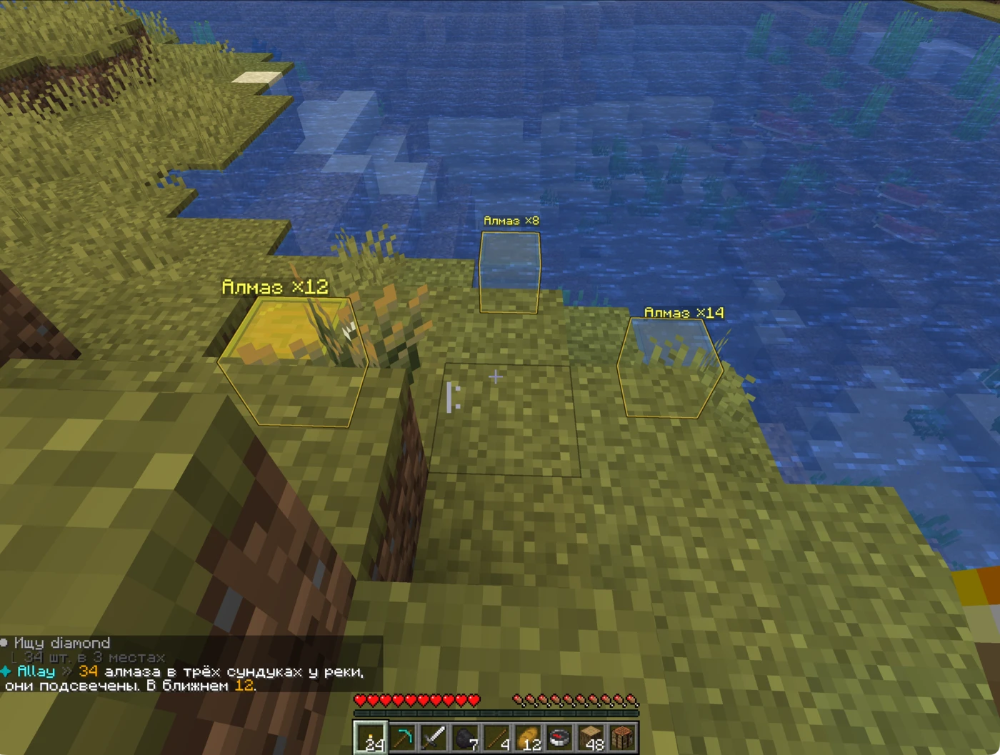
   Тропа к деревне · Подсвеченные сундуки с алмазами

  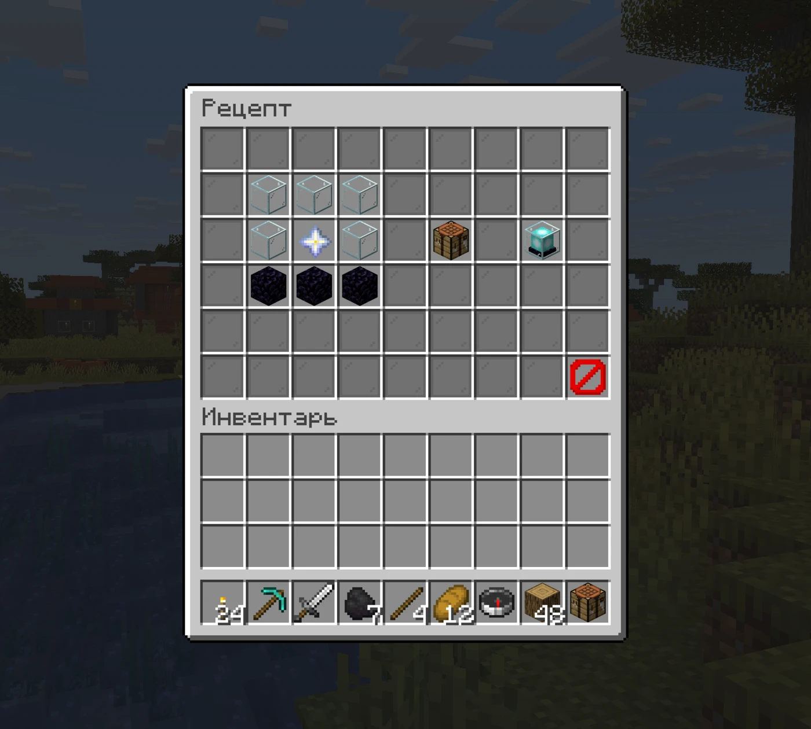
  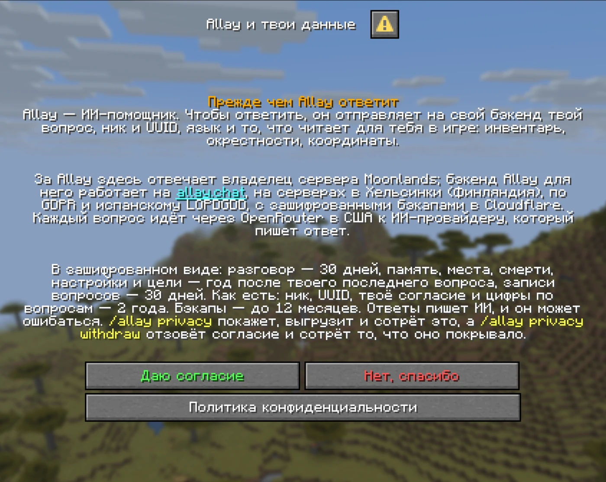
   Окно рецепта · Перед первым вопросом каждый игрок читает, что Allay отправляет и хранит

## Что вы получаете

- 💬 **Ответы из настоящей игры.** «Какой меч лучше?» или «куда я дел редстоун?» — Allay заглядывает в инвентарь, в блок под прицелом и в сундуки вокруг, а не гадает.
- 🔎 **Знает, что есть на этом сервере.** Предметы модов, рецепты и варка из датапаков, собственные предметы плагинов: Allay находит их по названию на любом языке или по id и не говорит «такого нет», пока не проверит. Знает и команды, которые вам здесь доступны, и чьи они, поэтому `/askx` пишет команду плагина так, как её ждёт плагин.
- 🗨️ **Режим чата.** `/allay chat` отправляет Allay всё, что пишет игрок, а `/askall` спрашивает при всех.
- 🧭 **Он показывает и подсвечивает.** След из частиц к месту смерти, деревне или другу на локаторе. Светящиеся метки на сундуках, где лежит нужное.
- 🤖 **Агенты автоматизации берут рутину.** Они сортируют сундуки, плавят поровну, варят зелья в несколько заходов и крафтят на настоящем верстаке, пока вы играете.
- 🏠 **Настоящие постройки из ваших блоков.** «Найди современную виллу» — и Allay предложит постройки их авторов из своего каталога. Превью видите только вы: его можно повернуть, заменить материалы, а потом Allay построит его блок за блоком из ваших сундуков и подождёт, если чего-то не хватает. Включает владелец сервера.
- 🧹 **Порядок в инвентаре.** «Меч первым, еда в последний ряд», а **[Вернуть как было]** отменяет сортировку.
- 🪟 **Кнопки и окна.** Кнопки стоят прямо в ответе: путь куда-то, рецепт, шаги варки, самый дешёвый порядок на наковальне, чары, сделки жителей или сообщение, которое Allay написал за вас. Память и приватность открываются в окнах самой игры.
- 🌍 **Каждый игрок читает свой язык.** Английский, русский, испанский, португальский и немецкий: по стране или на выбор через `/allay language`.
- 🔒 **Честно и безопасно.** Allay видит только вещи спросившего, не выдаёт предметы обычным игрокам и уважает приваты и ваниш.
- 🧱 **Плагин и мод.** Один и тот же Allay работает плагином на Spigot и Paper и модом на Fabric и NeoForge: на выделенном сервере или в вашем одиночном мире, где помогает только вам.
- 🛡️ **Приватность с самого начала.** Ваш сервер подписывает каждый запрос к бэкенду, а бэкенд держит игроков разных серверов порознь. `/allay privacy` расскажет игроку, что о нём хранится, и сотрёт это по просьбе, а полная приватность скроет его ник от панели администратора бэкенда.

## Приватность и закон

Allay соблюдает законы о данных ЕС (GDPR) и США. Вот что он делает с данными игроков на общем бэкенде [allay.chat](https://allay.chat/privacy/) по GDPR, испанскому LOPDGDD, COPPA и CCPA/CPRA:

- 🇪🇺 **Хранение в ЕС**, на серверах в Хельсинки, Финляндия. Зашифрованные ночные бэкапы лежат в Cloudflare R2 до 12 месяцев.
- 🔐 **Зашифровано AES-256-GCM:** разговоры, память и места, смерти, настройки и цели, записи вопросов. Без шифрования: справочник игроков (ник, UUID, статус оператора), цифры по каждому вопросу и запись о каждом согласии.
- ⏳ **Сроки:** разговор — 30 дней; память, места, смерти и настройки — год после последнего вопроса игрока; записи вопросов — 30 дней; цифры и справочник игроков — 2 года.
- 🌐 **Каждый вопрос идёт через OpenRouter в США** к ИИ-провайдеру, который пишет ответ.
- ✋ **Сначала возраст и согласие.** Перед первым вопросом окно спрашивает у игрока из ЕС или США возраст, и он должен быть не меньше возраста согласия в его стране (от 13 до 16 в ЕС, 14 в Испании, 13 в США), а потом каждый игрок соглашается с коротким уведомлением — и снова, когда оно меняется. Если игрок младше, Allay ничего не отвечает и ничего не отправляет. С allay.chat никакая настройка в `config.yml` этого не отключает.
- 📦 **Игрок распоряжается своими данными.** `/allay privacy` покажет, что хранится, даст ссылку на скачивание на 24 часа и сотрёт всё. `/allay privacy withdraw` отзовёт согласие и сотрёт то, что оно покрывало.
- 👥 **Другие игроки остаются без имён.** Игрок, который не дал согласия, попадает к ИИ только как «Player 1», «Player 2».
- 🧹 **Ваш сервер почти ничего не хранит:** данные игрока живут в памяти, пока он играет, а в папке Allay лежат только зашифрованные списки тех, кто согласился, и тех, кто оказался слишком юным.

## С чего начать

1. Поставьте Allay, на Java 25:
   - **Spigot или Paper 26.3:** [`allay-spigot.jar`](https://github.com/allay-ai/minecraft/releases/latest/download/allay-spigot.jar) в `plugins/`, затем перезапустите сервер.
   - **Fabric 26.3:** [`allay-fabric.jar`](https://github.com/allay-ai/minecraft/releases/latest/download/allay-fabric.jar) и [Fabric API](https://modrinth.com/mod/fabric-api) в `mods/` сервера или своей игры. Kotlin уже внутри, больше ничего не нужно.
   - **NeoForge 26.3:** [`allay-neoforge.jar`](https://github.com/allay-ai/minecraft/releases/latest/download/allay-neoforge.jar) в `mods/` сервера или своей игры. Kotlin уже внутри, больше ничего не нужно.

   Плагин есть и на [Hangar](https://hangar.papermc.io/MairwunNx/AllayAI), а плагин и оба мода появятся на Modrinth, когда там закончится проверка.
2. Оператором выполните `/allay link` для подписки или впишите свой ключ OpenRouter в `provider.byok` и выполните `/allay reload`. В одиночной игре это может хозяин мира, с читами или без.
3. Напишите `/ask как скрафтить маяк?`. Дальше ведёт страница [Installation](https://github.com/allay-ai/minecraft/wiki/Installation): Docker, свой бэкенд и лимиты.

## Документация

Руководство живёт в [вики](https://github.com/allay-ai/minecraft/wiki), на английском.

**Игрокам и владельцам серверов:** [Installation](https://github.com/allay-ai/minecraft/wiki/Installation) · [Paying for the model](https://github.com/allay-ai/minecraft/wiki/Paying-for-the-model) · [First steps](https://github.com/allay-ai/minecraft/wiki/First-steps) · [Asking Allay](https://github.com/allay-ai/minecraft/wiki/Asking-Allay) · [What Allay can do](https://github.com/allay-ai/minecraft/wiki/What-Allay-can-do) · [Automation agents](https://github.com/allay-ai/minecraft/wiki/Automation-agents) · [Builds](https://github.com/allay-ai/minecraft/wiki/Builds) · [Commands and permissions](https://github.com/allay-ai/minecraft/wiki/Commands-and-permissions) · [Configuration](https://github.com/allay-ai/minecraft/wiki/Configuration) · [Languages](https://github.com/allay-ai/minecraft/wiki/Languages) · [Integrations](https://github.com/allay-ai/minecraft/wiki/Integrations) · [Coming from MCBuddy](https://github.com/allay-ai/minecraft/wiki/Coming-from-MCBuddy) · [FAQ](https://github.com/allay-ai/minecraft/wiki/FAQ)

**Разработчикам:** [Building from source](https://github.com/allay-ai/minecraft/wiki/Building-from-source) · [Architecture](https://github.com/allay-ai/minecraft/wiki/Architecture) · [Releasing](https://github.com/allay-ai/minecraft/wiki/Releasing) · [Development](https://github.com/allay-ai/minecraft/wiki/Development) · [Expansions](https://github.com/allay-ai/minecraft/wiki/Expansions)

**Расширьте Allay из своего плагина или мода.** Библиотека `chat.allay:allay-expansion` с Maven Central: один класс даёт Allay инструменты, которые вызывают ваш код, ваши предметы и рецепты и несколько строк совета для модели — на Paper, Spigot, Fabric и NeoForge одинаково. Как это сделать, с примером для каждой платформы, — на странице [Expansions](https://github.com/allay-ai/minecraft/wiki/Expansions).

## Связанные проекты

- **[Moonlands](https://minecraft.mairwunnx.com)** — хардкорный сервер выживания, где всё это работает.
- **[WorldAPI](https://github.com/MairwunNx/minecraft-worldapi)** — REST и WebSocket API к миру, игрокам и статистике сервера на Paper, Fabric или NeoForge.
- **[Minecraft MCP](https://github.com/MairwunNx/minecraft-mcp)** — даёт AI-клиенту читать сервер и управлять им через WorldAPI.
- **[Allay Server](https://github.com/allay-ai/server)** — бэкенд Allay.
- **[Mo’Joins](https://github.com/MairwunNx/mojoins)** — сообщения о входе и выходе на языке каждого игрока.
- **[Mo’Afks](https://github.com/MairwunNx/moafks)** — безопасный AFK-режим, который не мешает пропустить ночь.
- **[Mo’Bosses](https://github.com/MairwunNx/mobosses)** — мобы, которые появляются боссами с классами, способностями и добычей.
- **[minecraft-exporter](https://github.com/MairwunNx/minecraft-exporter)** — метрики Prometheus из WorldAPI.
- **[minecraft-grafana](https://github.com/MairwunNx/minecraft-grafana)** — дашборд Grafana для WorldAPI.

[IP Geolocation by DB-IP](https://db-ip.com), лицензия CC BY 4.0.

## Раскрытие контента

- 🤖 **Код от ИИ.** Большую часть кода написали ИИ-агенты.
- ✨ **Генеративный ИИ.** Allay — ИИ-помощник: `/ask` отправляет вопрос языковой модели, и она отвечает по инвентарю и окружению игрока.
- 📡 **Данные — с согласия.** Перед первым вопросом каждый игрок читает, что отправляет Allay, и соглашается: вопрос с контекстом игры, время работы игровых инструментов, id сервера и лицензию.
- 💳 **Платное.** Ответы через allay.chat работают по подписке. Свой ключ OpenRouter или свой Allay Server работают без неё.
- Рекламы, чужих работ и вспышек нет.

> 🫡 Сделал Павел Ерохин (Pavel Erokhin), он же mairwunnx.
